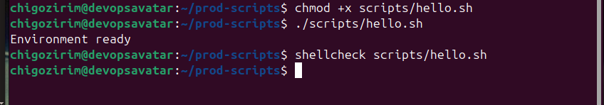
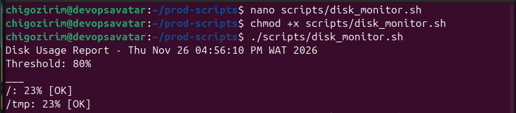
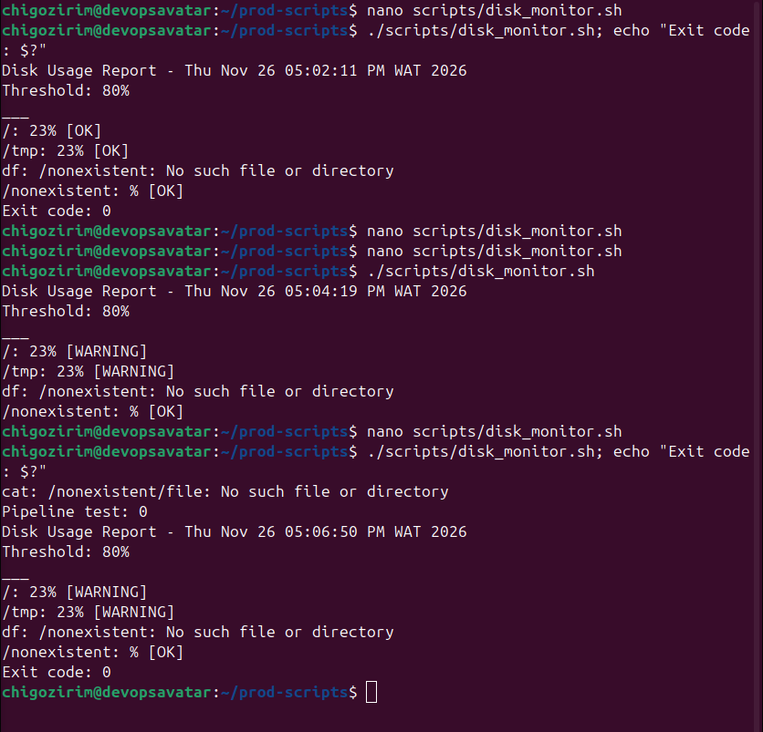
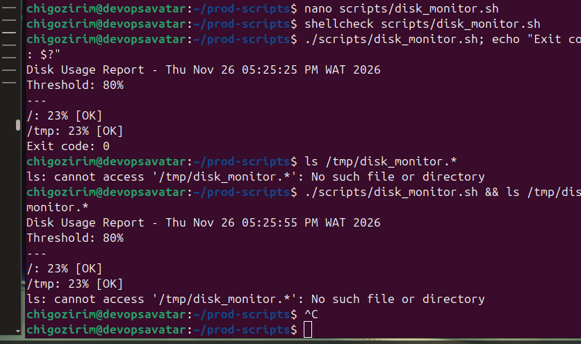
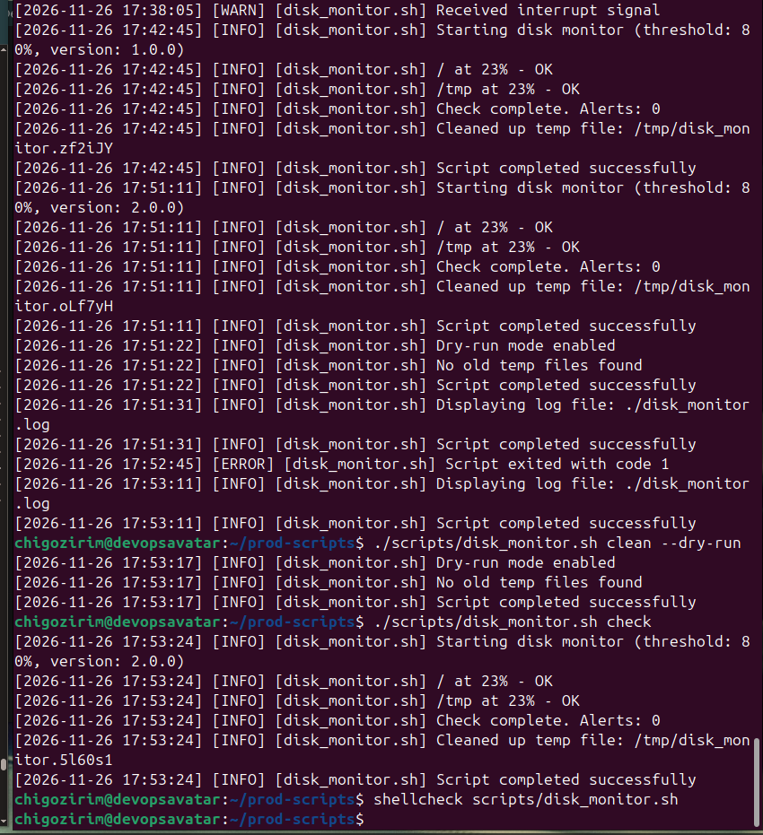

# Disk Space Monitor: Production-Ready Bash

A Bash script that monitors disk usage across mount points and warns when usage exceeds a threshold. It is hardened to run unattended (for example, via cron or CI), with strict error handling, automatic cleanup, structured logging and a dry-run mode.

**Author:** Dennis Chigozirim

## Features

- Per-mount disk usage checks against a threshold
- Strict mode (`set -euo pipefail`)
- `trap`-based cleanup of temporary files on failure or interrupt
- Timestamped `INFO` / `WARN` / `ERROR` logs, written to the terminal and a log file
- Input validation with clear error messages
- Subcommands and a dry-run mode for safe previews

**Tools:** Bash, `df`, `tail`, `awk`, `tr`, ShellCheck, Git

## Usage

Run from the project root:

```bash
# Check disk usage (default threshold: 80%)
./scripts/disk_monitor.sh check

# Preview temp file cleanup without changing anything
./scripts/disk_monitor.sh clean --dry-run

# Lint the script
shellcheck scripts/disk_monitor.sh
```

## Development Process

### 1. Environment Setup

I set up a Git-tracked project directory with ShellCheck to catch bugs and bad patterns before runtime. A minimal test script passed ShellCheck with no warnings.



### 2. Baseline Disk Monitor

The first version checks each mount point and produces a disk usage report. A pipeline of `df`, `tail`, `awk` and `tr` isolates the mount point's line, extracts the usage column and strips the `%` sign, leaving a number to compare against the threshold.



### 3. Failure Analysis

I deliberately broke the baseline script to expose three silent failure modes:

| Failure mode | Effect |
|---|---|
| Ignored command failure | Execution continues after a command fails |
| Variable name typo | The script silently produces wrong results |
| Upstream pipeline failure | The exit code hides the error |

Each can make a script appear successful while it is actually failing, so no alert is raised.



### 4. Hardening with Strict Mode and Traps

| Setting | Protection |
|---|---|
| `set -e` | Exits when an unhandled command fails |
| `set -u` | Treats unset variables as errors |
| `set -o pipefail` | Fails a pipeline if any command in it fails |

A `trap`-based cleanup function removes temporary files on crashes or `Ctrl+C`. Expected failures are handled explicitly so they do not terminate the script.

The hardened script passes ShellCheck, exits with code `0` and leaves no temporary files behind.



### 5. Structured Logging and Input Validation

Log entries carry a timestamp and severity level, which makes unattended failures easier to diagnose. Signal handling manages interruptions, and invalid arguments are rejected before they can cause damage.

For example, a threshold of `abc` produces the following error and exit code `1`:

```text
[ERROR] Threshold must be a number between 1 and 100, got: abc
```

### 6. Subcommands and Dry-Run Mode

A `run()` wrapper intercepts destructive commands. In dry-run mode, it prints what would happen without deleting files or changing the system.



## Challenges

Structuring the `trap` cleanup so that it did not interfere with normal execution.

## Future Improvements

- Use more advanced Bash array handling
- Evaluate Python for larger systems administration tasks
